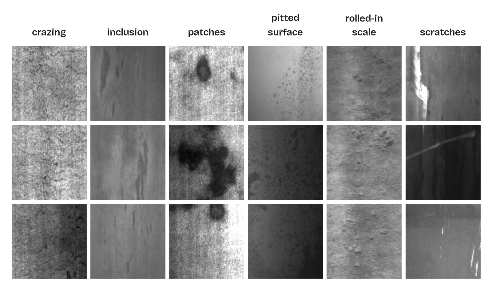
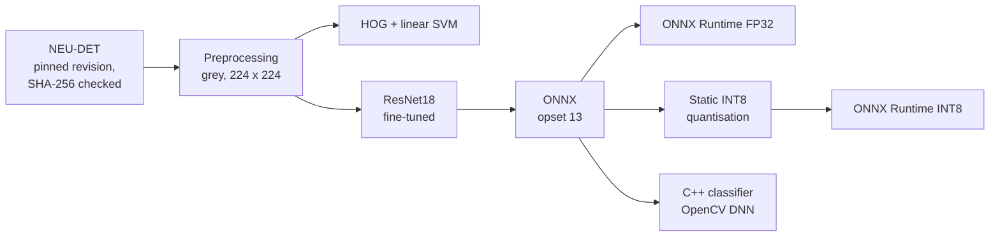
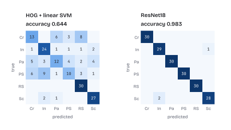
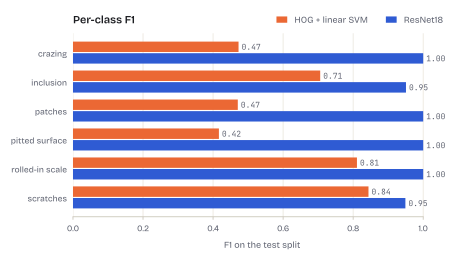
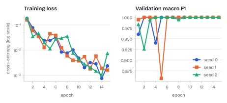
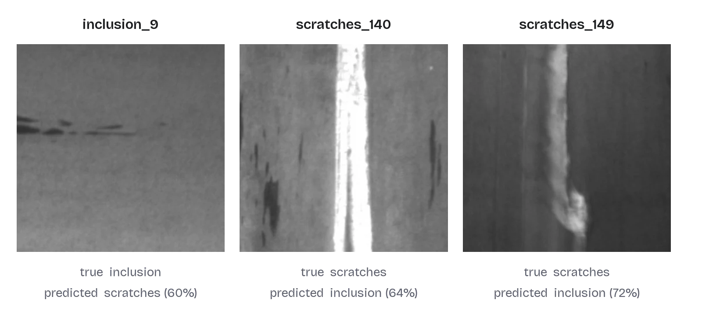
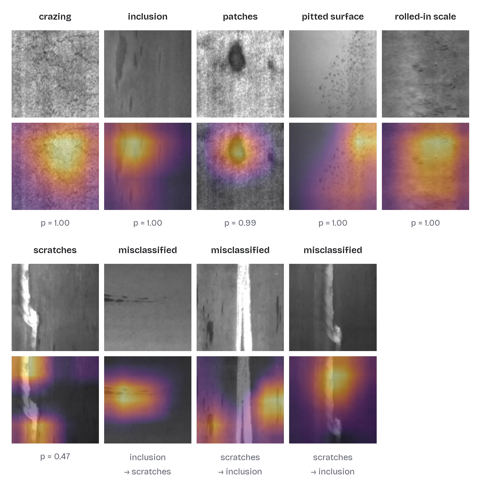
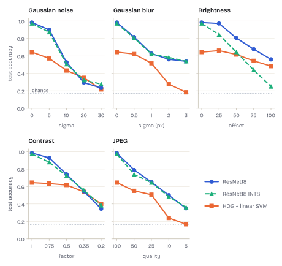

# Surface Defect Inspection

[](https://github.com/BenBotsch/SurfaceDefectInspection/actions/workflows/ci.yml)


[](LICENSE)

Classifies hot-rolled steel surface defects on the NEU surface defect database (NEU-DET) into six
classes, from a classical HOG + linear SVM baseline to a fine-tuned ResNet18. The model is exported
to ONNX and runs in three places that must agree: PyTorch, ONNX Runtime and a small C++ classifier
built on OpenCV DNN, which has its own preprocessing and a parity test against Python. An INT8 copy
of the model, a robustness study and a latency benchmark show what changes on the way from a
notebook result to an inspection station.

<picture>
  <source media="(prefers-color-scheme: dark)" srcset="docs/figures/samples-dark.webp">
  
</picture>

## Results at a glance

Test split of 180 images (30 per class). Each model was chosen by validation macro F1, and the test
split was read only for these numbers.

| Model | Test accuracy | Macro F1 | Model size | CPU latency |
| --- | ---: | ---: | ---: | ---: |
| HOG + linear SVM | 0.644 | 0.620 | n/a | n/a |
| ResNet18, mean ± std over seeds 0, 1 and 2 | 0.993 ± 0.008 | 0.993 ± 0.008 | 44.8 MB | 23.4 ms |
| ResNet18 seed 0, ONNX Runtime FP32 | 0.983 | 0.983 | 44.7 MB | 9.7 ms |
| ResNet18 seed 0, ONNX Runtime INT8 | 0.972 | 0.972 | 11.3 MB | 5.7 ms |

Latency is the median for one image at batch size 1, including preprocessing, on a desktop Intel
CPU (Comet Lake, 6 threads). The PyTorch figure is for the same model in eager mode. Every number
in this README comes from a file in [results/](results/), and every figure from an `sdi` command
(see [Run it](#run-it)).

## Pipeline



## Results

The confusion matrices show where the two models differ. The baseline mixes up the three texture
classes crazing, patches and pitted surface, which HOG describes badly. The ResNet18 of seed 0
makes three errors, all between inclusion and scratches.

<picture>
  <source media="(prefers-color-scheme: dark)" srcset="docs/figures/confusion-dark.svg">
  
</picture>

<picture>
  <source media="(prefers-color-scheme: dark)" srcset="docs/figures/per_class_f1-dark.svg">
  
</picture>

Training is short. The validation F1 of all three seeds reaches 1.0 within four epochs, with single
dips afterwards, and the first epoch with the best validation F1 is kept.

<picture>
  <source media="(prefers-color-scheme: dark)" srcset="docs/figures/training-dark.svg">
  
</picture>

The three misclassified test images, with the class the model chose and its probability. All three
show elongated marks along the rolling direction, where inclusions and scratches look alike.

<picture>
  <source media="(prefers-color-scheme: dark)" srcset="docs/figures/errors-dark.webp">
  
</picture>

## What the model looks at

Grad-CAM ([Selvaraju et al., 2017](https://arxiv.org/abs/1610.02391)) weights the activations of
the last residual stage by the gradient of the class score. Brighter regions in the lower row
raised the score of the predicted class. For crazing, inclusion, patches and rolled-in scale the
map lies on the defect. For pitted surface it lies at the edge of the pitted area. The correct
scratches example has a probability of only 0.47, and its map sits on the ends of the scratch
rather than along it. In both scratches images that were taken for inclusions, the map lies beside
the scratch and not on it, so the model decided on the surrounding surface.

<picture>
  <source media="(prefers-color-scheme: dark)" srcset="docs/figures/gradcam-dark.webp">
  
</picture>

## Robustness

The test images were corrupted at five levels each by Gaussian noise, Gaussian blur, a brightness
offset, reduced contrast and JPEG compression. Level 0 is the clean image, and the noise is seeded,
so every model sees the same corrupted images.

<picture>
  <source media="(prefers-color-scheme: dark)" srcset="docs/figures/robustness-dark.svg">
  
</picture>

The ResNet18 is far less robust than its clean accuracy suggests. Gaussian noise with a standard
deviation of 10 grey levels halves its accuracy to 0.528, a blur of 1 pixel brings it to 0.628, and
JPEG at quality 50 to 0.789. Training only augments brightness by up to 15 grey levels and contrast
by up to 15 %, so most of these levels are outside what the model has seen. The INT8 model follows
the float model under noise, blur, contrast and JPEG, but it fails much earlier on brighter images,
with 0.250 against 0.561 at an offset of 100. A likely cause is that its activation ranges were
calibrated on unmodified training images and clip the larger activations of brighter input. That
explanation has not been tested. The full table is in
[results/robustness.md](results/robustness.md).

## Runtimes

The same image through every runtime on the same machine, 200 timed calls after 20 warm-up calls.

| Runtime | Device | Test accuracy | Model size | Median latency | p95 latency |
| --- | --- | ---: | ---: | ---: | ---: |
| PyTorch | Intel Core (Comet Lake), 6 threads | 0.983 | 44.8 MB | 23.41 ms | 26.65 ms |
| PyTorch | NVIDIA Quadro RTX 4000 | 0.983 | 44.8 MB | 3.55 ms | 5.38 ms |
| ONNX Runtime FP32 | Intel Core (Comet Lake), 6 threads | 0.983 | 44.7 MB | 9.66 ms | 10.51 ms |
| ONNX Runtime INT8 | Intel Core (Comet Lake), 6 threads | 0.972 | 11.3 MB | 5.73 ms | 6.63 ms |
| OpenCV DNN (C++) | same CPU, Docker on WSL2, 12 threads | n/a | 44.7 MB | 15.92 ms | 18.90 ms |

INT8 quantisation is static, with per-channel weights in the QDQ format, and calibrated on the
first 20 training images of each class. Percentile calibration was chosen over min-max and entropy
calibration on the validation split. The C++ classifier runs in a Linux container under WSL2 with
the OpenCV 4.6 package of Ubuntu 24.04, so its time is only roughly comparable to the native
Windows runs. It loads the FP32 model only, because the importer of OpenCV 4.6 DNN fails on the
`DequantizeLinear` nodes of the quantised graph. The table is generated as
[results/benchmark.md](results/benchmark.md).

The pipeline does not measure the test accuracy of the C++ classifier, hence n/a. A separate script
ran the model trained with the defaults at commit `19773a8` through the C++ preprocessing on all
180 test images once: it predicted the same class as ONNX Runtime for every image, so its accuracy
is also 0.983, and no probability differed by more than 1.1e-6.

## What these numbers do and do not say

NEU-DET is close to saturated for classification. The validation F1 reaches 1.0 within four epochs,
and one test image is worth 0.6 points of accuracy. The differences between seeds are one to three
images and are not evidence that one run is better. The data is also easier than production
inspection, because every image is a 200 x 200 crop that shows a single defect class. The baseline
shows why learned features matter here. It does not show that the model would hold up on a
different line, camera or defect mix. The robustness study points the same way. Noise of 10 grey
levels or a blur of one pixel costs the model more than a third of its accuracy, and the INT8 copy
depends on how representative its calibration images are. A deployment would need data from that
line, augmentation that matches its conditions and a detection or segmentation model instead of a
classifier.

## Run it

Needs [uv](https://docs.astral.sh/uv/). On Windows the CUDA 12.6 build of PyTorch is installed, on
Linux the CPU build.

```text
uv sync
uv run sdi download        # NEU-DET at a pinned revision, every image checked against its SHA-256
uv run sdi baseline        # HOG + linear SVM -> results/baseline.{json,md}
uv run sdi train           # ResNet18 -> runs/model.pt, runs/history.json, runs/config.json
uv run sdi evaluate        # PyTorch and ONNX Runtime on the test split -> results/
uv run sdi export          # runs/model.onnx for the C++ classifier
uv run pytest              # unit tests, ONNX parity, a training smoke test on synthetic images
uv run pre-commit install  # ruff, ruff format and clang-format before every commit
```

The multi-seed table, the figures and the studies above:

```text
uv run sdi train --seed 1 --run-dir runs/seed1
uv run sdi train --seed 2 --run-dir runs/seed2
uv run sdi seeds runs runs/seed1 runs/seed2    # -> results/seeds.{json,md}, results/seeds/
uv run sdi figures                             # -> docs/figures/, light and dark, SVG/WebP + PNG
uv run sdi gradcam                             # -> docs/figures/gradcam.webp
uv run figkit check docs/figures               # pairs, transparency and file sizes
uv run sdi robustness                          # -> results/robustness.{json,md}, figure
uv run sdi benchmark                           # INT8 model, -> results/benchmark.{json,md}
uv run sdi report --check                      # results/*.md still match results/*.json
```

The C++ classifier needs CMake and OpenCV 4 with the DNN module (`libopencv-dev` on Ubuntu 24.04):

```text
uv run sdi parity-fixture /tmp/fixture
cmake -S cpp -B build -DSDI_FIXTURE=/tmp/fixture
cmake --build build -j
ctest --test-dir build --output-on-failure
build/sdi-classify runs/model.onnx image.jpg ...
build/sdi-classify --bench 200 runs/model.onnx image.jpg
```

Or in a container, exactly as in CI, and with the benchmark row of the table above:

```text
docker build -t sdi-cpp -f cpp/Dockerfile .
docker run --rm -v "$PWD/runs:/runs:ro" -v "$PWD/data:/data:ro" sdi-cpp \
    build/sdi-classify --bench 200 /runs/model.onnx /data/neu-det/images/test/crazing_101.jpg \
    > results/benchmark_cpp.json
uv run sdi benchmark
```

## Design

- **Data.** The images come from the cleaned release
  [`KeenForgeAI/NEU-DET-corrected`](https://huggingface.co/datasets/KeenForgeAI/NEU-DET-corrected),
  which removes duplicate images and fixes a seeded, class-stratified 80/10/10 split. The
  revision is pinned in `src/sdi/dataset.py`, so every run sees the same files.
- **Model.** ResNet18 with ImageNet weights. The images are greyscale, so the first convolution
  takes one channel, with its pretrained weights summed over the three colour channels. That
  gives a grey image the same response the RGB version would get.
- **Augmentation.** Horizontal and vertical flips plus a mild brightness and contrast change. No
  90-degree rotations, because scratches and rolled-in scale follow the rolling direction.
- **Model selection** uses the validation split only. The test split is read once per evaluation.
- **ONNX.** Exported at opset 13 with a softmax head and a dynamic batch size. The exporter's
  `Identity` nodes are removed afterwards, because OpenCV 4.6 DNN (the Ubuntu 24.04 package)
  cannot import them. A test guards against that.
- **Parity.** `src/sdi/preprocess.py` and `cpp/src/classifier.cpp` implement the same resize and
  normalisation. `sdi parity-fixture` writes an untrained model, a synthetic image and the
  probabilities Python computes, so the C++ test needs neither the dataset nor a trained model.
  The C++ probabilities match ONNX Runtime to within 7.5e-8, and the test fails above 1e-5. It
  also checks itself: six plausible porting errors (nearest or area interpolation, the red channel
  constants, no normalisation, swapped axes, resizing in float) must each exceed the tolerance.
  The earlier tolerance of 1e-4 let resizing in float pass at 5.4e-5.
- **INT8.** The softmax stays in float, so the quantised model still returns probabilities.
  Calibration never reads the test split.
- **Reproducible reports.** Results are written as JSON first. `sdi report` renders the Markdown
  tables from the JSON, and CI fails when the two disagree. Figures are rendered for light and dark
  pages from the same files.

## Layout

```text
src/sdi/           dataset, preprocessing, baseline, model, training, metrics, ONNX export,
                   INT8, Grad-CAM, robustness, benchmark, figures, CLI
tests/             pytest
cpp/               C++ classifier with a benchmark mode, parity test, CMake, Dockerfile
results/           metrics, predictions, per-seed results, robustness and benchmark tables
docs/figures/      README figures, light and dark, transparent for other web pages
```

[MODEL_CARD.md](MODEL_CARD.md) summarises intended use, data, metrics and limits of the model.

## Roadmap

- Detection with the bounding boxes that NEU-DET provides, which matches real inspection better
  than whole-image classification.
- Corruption-aware augmentation and INT8 calibration on corrupted images, measured with
  `sdi robustness`.
- An interactive demo and a GitHub release that ships the ONNX models.

## Data licence and citation

The full dataset is not part of this repository, and `sdi download` fetches it. The figures in
`docs/figures/` show a small number of downsized images from the cleaned release
[`KeenForgeAI/NEU-DET-corrected`](https://huggingface.co/datasets/KeenForgeAI/NEU-DET-corrected),
which is published under [CC BY 4.0](https://creativecommons.org/licenses/by/4.0/). The original
database has no stated licence. If you use the data, cite the original work:

> K. Song and Y. Yan, "A noise robust method based on completed local binary patterns for
> hot-rolled steel strip surface defects," Applied Surface Science, vol. 285, pp. 858-864, 2013.

The code is under the [MIT licence](LICENSE).
