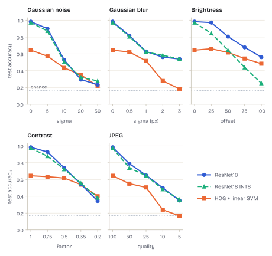

# Figures

The figures of the README, written by `sdi figures` and `sdi gradcam` with
[FigureKit](https://github.com/BenBotsch/FigureKit), the shared figure style of my projects. They
can be used unchanged on other web pages.

- Every figure exists twice: `<name>.<ext>` for light pages and `<name>-dark.<ext>` for dark pages,
  because the text colour differs. The background is transparent.
- Charts (`confusion`, `per_class_f1`, `training`, `robustness`) are SVG and stay sharp at any
  width. A transparent PNG with the same name is the fallback for places without SVG.
- Photographs (`samples`, `errors`, `gradcam`) are WebP, with a transparent PNG as fallback. All
  raster files are 1600 pixels wide, sharp on high-density screens in a column of up to 800 CSS
  pixels.
- Every figure has the same 6.4 inch canvas (460.8 pt as SVG), so text has the same size in all of
  them, about 15 pixels in a column of 800 CSS pixels. Grad-CAM wraps into two rows and the
  robustness panels into a 3 x 2 grid.
- `uv run figkit check docs/figures docs/figures/page` checks the pairs, the transparency, the
  canvas width, text below 8 pt and the file sizes, and in `page/` the languages and the manifest;
  CI runs it on every push.

Scale the images with the column, for example with `width: 100%; height: auto`.

```html
<picture>
  <source media="(prefers-color-scheme: dark)" srcset="robustness-dark.svg">
  
</picture>
```

## Page files for a website

`page/` holds the charts and `gradcam` without their title, because the page sets the title as
text. `samples` and `errors` are not there. Each figure exists in English and German, for a light
and a dark page:

```text
page/<name>.en.svg        English, light page (gradcam: .webp)
page/<name>.en-dark.svg   English, dark page
page/<name>.de.svg        German, light page
page/<name>.de-dark.svg   German, dark page
page/figures.json         title, subtitle, alt text and files per language, size in pt
```

German figures write numbers as `0,983` and `1.500` and keep the NEU-DET class names in English.
The texts in `figures.json` are computed from the same results as the figures, so a page reads its
title, caption and alt text from there. The subtitle of `gradcam` is the attribution below.
`sdi figures` writes the charts, `sdi gradcam` the Grad-CAM figure; each rewrites the manifest for
the files on disk.

## Attribution

`samples`, `errors` and `gradcam` contain images from NEU-DET and need a credit wherever they are
shown, for example:

> Images: NEU surface defect database (K. Song and Y. Yan, 2013), cleaned release
> [KeenForgeAI/NEU-DET-corrected](https://huggingface.co/datasets/KeenForgeAI/NEU-DET-corrected),
> [CC BY 4.0](https://creativecommons.org/licenses/by/4.0/). Downsized, Grad-CAM overlays added.

The charts contain no dataset images.
